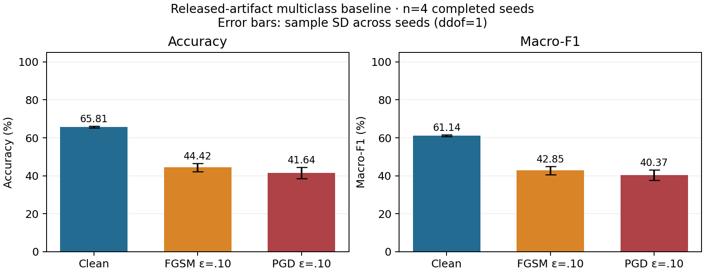

# Transformer intrusion detection: robustness and efficiency

Research question: **How do INT8 quantization and adversarial training change the
robustness–efficiency trade-off of a Transformer for IoT intrusion detection?**

**Released-artifact multiclass baseline completed across four seeds.
Matched-condition reproduction of the published Table 4 results remains
unresolved.**

The PAVE Standard Transformer predicts one of **27 classes**: benign traffic or
one of 26 attack labels in the released, balanced CICIoT subset. It receives a
synthetic length-50 sequence made by repeating a row of 39 standardized features;
these are not 50 chronological network flows.

## Start here

1. [Milestone 1 report](reports/milestone1-artifact/REPORT.md) — authoritative
   methods, results, validity limits and official requirements checklist.
2. [Setup and commands](docs/SETUP.md) — environment, dataset acquisition/hash,
   baseline reproduction and report regeneration.
3. [Frozen baseline configuration](configs/milestone1_artifact_full.json),
   [per-seed metrics](reports/milestone1-artifact/per_seed.csv),
   [aggregate metrics](reports/milestone1-artifact/summary.csv) and
   [compact experimental evidence](reports/milestone1-artifact/evidence/README.md).
4. [Repository inclusion and verification guide](docs/REPOSITORY_REVIEW.md) —
   what belongs in Git, what stays local, and lightweight review checks.

## What Milestone 1 executed

The **released-artifact multiclass baseline and documented paper-reproduction
attempt** used the entire 29,997-row processed CSV, ordinary FP32 Standard
Transformer only, and seeds **1, 7, 13, 29**. Each seed completed 15 epochs,
705 Adam updates, and evaluation of the same final checkpoint on 3,000 aligned
validation examples under clean, FGSM and PGD conditions. Clean means unperturbed;
the original class labels are retained under both attacks.

Mean ± **sample standard deviation across four seeds** (percentage points for
accuracy and F1):

| Condition | Accuracy (%) | Macro-F1 (%) | Weighted-F1 (%) |
| --- | --- | --- | --- |
| Clean | 65.81 ± 0.43 | 61.14 ± 0.42 | 61.15 ± 0.41 |
| FGSM, ε = 0.10 | 44.42 ± 2.12 | 42.85 ± 2.15 | 42.86 ± 2.16 |
| PGD, ε = 0.10 | 41.64 ± 2.97 | 40.37 ± 2.75 | 40.38 ± 2.77 |

The report also contains MCC, clean-correct untargeted ASR, runtime and per-class
evidence. PGD uses 10 steps, α = 0.01, clean initialization and epsilon-box
projection; neither attack enforces protocol constraints. Training took 4,397.54 s
and evaluation 369.76 s; the overall run span was 1 h 20 min 48 s on a local CPU.

These are capped **validation** results under inherited artifact choices:
whole-file StandardScaler before splitting, stratified 80/20 partitions varying
with seed, and possible duplicate leakage. They do not establish held-out test
generalization, natural class prevalence or physically realizable network evasion.

The classification mode and generating configuration of the paper's Table 4 row
have not been established. Its metric definitions and experiment provenance are
also unresolved. Our baseline and the published row are potentially different
experiments; numerical reproduction under matched conditions is **not demonstrated**.
See the report and [bounded reference investigation](docs/MILESTONE1_REFERENCE.md).

## Code ownership and attribution

- **Upstream PAVE:** the pinned, unmodified checkout at
  `upstream/PAVE_artifact/` supplies the Standard Transformer, data loader,
  training helper, cap/inference functions and FGSM/PGD implementations. It is
  restored during setup and excluded from Git. Revision and source hashes are
  recorded in the frozen configuration.
- **Our group:** [artifact runner](research/artifact_baseline.py),
  [report generator](research/milestone1_report.py), checkpoint/resume and
  verification instrumentation, tests, configurations, reports and setup tools.
  The separate corrected research pipeline is also in `research/`.
- [PAVE attribution and license](NOTICE.md) identify the upstream authors and
  retain the upstream MIT license. No license for the group's original code is
  inferred from PAVE's license.

`research.reproduce` is a legacy mixed-model artifact wrapper, and
`research.milestone1` is the historical reference gate/component smoke.
`experiments/milestone1/run_*.py` evaluate corrected-pipeline checkpoints.
**The completed baseline uses `research.artifact_baseline`**, not these older paths.

## Later milestones

- **Milestone 2:** run the corrected protocol's full FP32/INT8 and adversarial
  training comparisons, attack curves and efficiency measurements.
- **Milestone 3:** complete the planned layer ablations, transfer/class-wise
  analyses and final robustness–efficiency synthesis.

Much of that functionality was implemented and tested on bounded smoke/pilot
runs; the full later-stage research experiments remain pending. Those tests are
not Milestone 1 baseline results. Read the [corrected protocol](docs/PROTOCOL.md)
and [historical implementation results](docs/VERIFIED_RESULTS.md) for context.
[PROGRESS.md](PROGRESS.md) preserves the execution history. No later milestone is
launched automatically.
