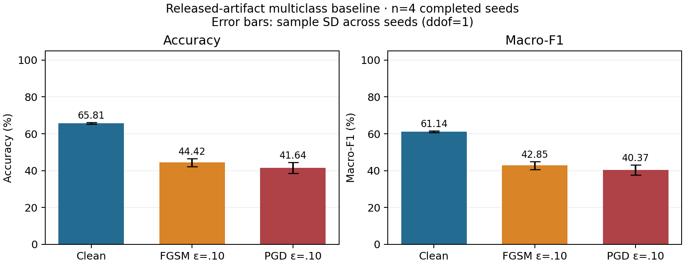

# Milestone 1: released-artifact multiclass baseline

**Released-artifact multiclass baseline and documented paper-reproduction attempt.**

## Objective, scope and completion

Run the ordinary FP32 PAVE Standard Transformer on released CICIoT data, evaluate
clean (unperturbed), FGSM and PGD inputs, and document the attempted paper comparison.
Clean includes unperturbed examples from **all 27 classes**, including malicious
traffic. Clean does not mean benign. The ground-truth class label stays unchanged
under FGSM and PGD: these attacks change the input, not its assigned label. This
evaluation convention does not establish that a perturbed tensor represents a
physically possible traffic example with that label.

Four full seeds completed and verified.

Exact Table 4 reproduction remains unresolved. This does not block the authorized
artifact attempt. No quantization, QAT, adversarial training, transfer experiment,
layer ablation, remote write or external compute is part of this work.

## Provenance and data

- Upstream: https://github.com/robotumbel/PAVE_artifact, revision `e73911bbdb241f3fb6c5de346139010c4aadefd4`.
- Dataset: `upstream/PAVE_artifact/data/balanced_CICIoT.csv`, SHA-256 `0d869e334cc9a2795c96996fbde8fb04a8acac61f5e67c5d46aee2b0717a53ed`.
- Entire CSV: 29,997 rows, 39 numeric features, 27 classes, 1,111 rows per class.
  Benign_Final is 3.7037% of this subset. This balanced subset does not establish
  natural traffic prevalence or natural minority-class behavior.
- Full feature order and alphabetical class mapping are frozen in `configuration.json`.
- Interpreter, package versions, CPU, RAM and execution metadata:
  [portable review metadata](review_metadata.json). The frozen config records threads.
  Local CPU only, two PyTorch threads; no concurrent training jobs.
- Paper: supplied pre-proof, DOI https://doi.org/10.1016/j.hcc.2026.100426,
  Table 4 printed p.12 / PDF p.16. The seven values were rechecked against the
  existing local extraction; the source PDF hash is recorded in `review_metadata.json`.
- Source/called-function hashes: `configuration.json`; checkpoint and per-seed
  manifest hashes/relative locations: `review_metadata.json`. Raw evidence remains
  in `runs/milestone1-artifact-full/` relative to the repository root.

| ID | Label | CSV rows |
| --- | --- | --- |
| 0 | Benign_Final | 1111 |
| 1 | DDoS-ACK_Fragmentation | 1111 |
| 2 | DDoS-HTTP_Flood | 1111 |
| 3 | DDoS-ICMP_Flood | 1111 |
| 4 | DDoS-ICMP_Fragmentation | 1111 |
| 5 | DDoS-PSHACK_Flood | 1111 |
| 6 | DDoS-RSTFINFlood | 1111 |
| 7 | DDoS-SYN_Flood | 1111 |
| 8 | DDoS-SlowLoris | 1111 |
| 9 | DDoS-SynonymousIP_Flood | 1111 |
| 10 | DDoS-TCP_Flood | 1111 |
| 11 | DDoS-UDP_Flood | 1111 |
| 12 | DDoS-UDP_Fragmentation | 1111 |
| 13 | DNS_Spoofing | 1111 |
| 14 | DoS-HTTP_Flood | 1111 |
| 15 | DoS-SYN_Flood | 1111 |
| 16 | DoS-TCP_Flood | 1111 |
| 17 | DoS-UDP_Flood | 1111 |
| 18 | MITM-ArpSpoofing | 1111 |
| 19 | Mirai-greeth_flood | 1111 |
| 20 | Mirai-greip_flood | 1111 |
| 21 | Mirai-udpplain | 1111 |
| 22 | Recon-HostDiscovery | 1111 |
| 23 | Recon-OSScan | 1111 |
| 24 | Recon-PingSweep | 1111 |
| 25 | Recon-PortScan | 1111 |
| 26 | VulnerabilityScan | 1111 |

## Architecture and input representation

A CSV row has 39 features. The artifact standardizes it and repeats it into a
synthetic sequence of 50 tokens. Training adds independent Gaussian noise with
standard deviation .01 at each time step. Evaluation repeats the row without noise.
These are not chronological observations of 50 real flows.

The unchanged upstream `StandardTransformerIDS` maps 39 features to width 96,
adds fixed sinusoidal positional encoding and dropout .1, then applies three
post-norm residual Transformer encoder blocks. Each has four attention heads
(24 dimensions each), Q/K/V/output linear projections, and a ReLU feed-forward
network of widths 96→384→96. Mean pooling over tokens feeds the classifier
96→48→27 logits. Cross-entropy trains the classifier; argmax selects the label.
The upstream 96→64→1 anomaly scorer remains instantiated but receives no auxiliary
loss in this ordinary baseline. The complete model has 351,612 parameters.

## Executed pipeline

1. Use all CSV rows; numeric coercion and missing/infinite values are replaced by zero.
2. Fit the released **StandardScaler on the entire CSV before splitting**. Retain
   this inherited methodological limitation, rather than silently substituting min–max.
3. Use upstream stratified `train_test_split(test_size=.20, random_state=seed)`:
   23,997 training rows and 6,000 validation rows. No independent test partition exists.
4. Construct the upstream synthetic training sequences with the replication seed.
5. Train ordinary FP32 for 15 epochs, batch 512 (including final short batch),
   Adam lr .001, default betas .9/.999, eps 1e-8, **zero weight decay** and ordinary
   cross-entropy. No scheduler, gradient clipping, adversarial samples or tuning.
6. Save the **final epoch 15**, without selecting it using evaluation performance.
   Each completed seed must contain 705 optimizer steps and 359,955 sample exposures.
7. Select 3,000 validation rows using unchanged `cap_aligned` with cap seed 42.
   Its per-class sampling plus remainder fill is preserved. Use exactly those row IDs
   for all three conditions and keep model.eval() during attacks and inference.
8. Use upstream attacks and inference with evaluation batch 32 to limit memory.
   This uses their supported `bs` argument; training batch remains 512.

Replication seeds are **1, 7, 13, 29**, predetermined before training; they are not
a claim about the paper's seeds. Python/numpy/torch training RNGs are explicitly
seeded as our addition. The same replication seed controls the inherited split
and sequence-noise generation. Variation therefore includes both training
randomness and changing partitions/evaluation examples. The cap seed stays 42,
but operates on each seed's different validation population.

The upstream `train_seq` statements are reused through AST instrumentation that
only adds an epoch range, optimizer/RNG restore and an end-of-epoch callback.
The optimizer, loss, shuffle, dropout and update statements are unchanged. Added
checkpoints save model, Adam state and CPU torch RNG after each complete epoch.
Tests establish exact parameter equality against uninterrupted upstream training,
including interruption/resume. Atomic saves and logs are our additions. Skipping
unneeded surrogate/AGT/GRU training also changes RNG consumption relative to the
artifact's mixed-model scripts; we disclose that isolation and seed the baseline.

## FGSM, PGD and metric definitions

FGSM takes one gradient-sign step that increases true-label cross-entropy:

`x_adv = x + ε sign(∇x CE(f(x), y))`, with `ε = .10`.

PGD repeatedly takes smaller steps, projecting each result to the epsilon box:

`x⁰ = x`

`xᵗ⁺¹ = clip(xᵗ + .01 sign(∇xᵗ CE(f(xᵗ), y)), x−.10, x+.10)`, for 10 steps.

These are untargeted attacks in the standardized **sequence tensor**. PGD starts
from the clean input without random initialization. Neither upstream function
clips to feature-domain boundaries or projects to protocol-valid traffic. Epsilon
.10 is in StandardScaler units, not ten percent of each raw feature's range.
Model parameters are unchanged during evaluation; input gradients are enabled.
Perturbation checks permit 1e-5 float32 roundoff, and retain each condition's
measured maximum. An observed maximum such as .10000038 is rounding at epsilon
.10, not an intentional larger attack budget.

- Accuracy: proportion of correctly classified evaluated rows.
- Macro-F1: arithmetic mean of all 27 per-class F1 values, zero_division=0.
- Weighted-F1: mean of class F1 values weighted by evaluation support.
- MCC: sklearn multiclass Matthews correlation.
- Untargeted ASR (%): 100 × newly incorrect examples among clean-correct examples
  divided by the number of clean-correct examples. Empty denominator → null.
  A wrong attack-family prediction counts; this is not a targeted
  malicious-to-benign evasion rate.
- Upstream `pave_audit._asr` is saved separately; its nonempty formula agrees,
  while its empty-denominator fallback returns zero. Prediction-change rate and
  total adversarial error are also separate diagnostics, not paper-equivalent ASR.

Metrics are saved without the upstream four-decimal rounding. Per-class
precision/recall/F1/support, confusion matrices, labels, predictions/logits and
row IDs are retained. Sample SD uses **ddof=1** across completed seeds; fewer
than two seeds cannot establish variability.

## Measured results

| Condition | Seeds | Accuracy (%) | Macro-F1 (%) | Weighted-F1 (%) | MCC | ASR (%) |
| --- | --- | --- | --- | --- | --- | --- |
| Clean | 4 | 65.808 ± 0.428 | 61.140 ± 0.423 | 61.148 ± 0.407 | 0.650 ± 0.004 | 0.000 ± 0.000 |
| FGSM | 4 | 44.417 ± 2.119 | 42.850 ± 2.145 | 42.860 ± 2.157 | 0.424 ± 0.022 | 33.739 ± 4.616 |
| PGD | 4 | 41.642 ± 2.967 | 40.372 ± 2.755 | 40.378 ± 2.773 | 0.396 ± 0.031 | 36.699 ± 4.942 |

Only completed, verified full-budget seeds enter this table and the figure.
`per_seed.csv` contains individual measurements; `summary.csv` contains unrounded
means and sample SD. Missing seeds are not filled with zeros or smoke results.



Completed-seed training time: **4397.54 seconds**. Completed evaluation
time: **369.76 seconds**. These are measured accumulated training and
evaluation durations, not estimates of uncompleted seeds; runtime records also
include per-invocation loading time and sampled peak RSS. Epoch checkpoints retain
progress if the session ends; `review_metadata.json` records completion.
Wall-clock span from initial run setup to the last completed seed is
4848 seconds;
it includes loading, verification and any idle gaps between sequential launches.

| Seed | Training (min) | Evaluation (min) | Peak process RSS (GiB) | Min system available (MiB) |
| --- | --- | --- | --- | --- |
| 1 | 21.56 | 1.58 | 1.45 | 58.7 |
| 7 | 16.96 | 1.56 | 1.49 | 108.9 |
| 13 | 17.57 | 1.55 | 1.44 | 186.0 |
| 29 | 17.19 | 1.46 | 1.38 | 243.0 |

Memory values are sampled, not exact allocation peaks. System-available memory
includes the effect of other applications; it is distinct from this process's RSS.
The run uses one training process, two CPU threads and evaluation batches of 32.

## Verification and failures

Every included seed passed dataset/hash/class/model checks, full-budget checkpoint
validation, exact checkpoint-reload logit equality over the evaluation population,
aligned examples across conditions, finite recomputed accuracy/F1/MCC, epsilon
bounds and epsilon-zero identity for actual upstream FGSM/PGD. An explicit input
gradient probe is finite/nonzero; state hashes establish no parameter updates
during attacks. Saved prediction coverage, confusion matrices, per-class support,
checkpoint identity and artifact checksums are verified. A process exit code alone
is not accepted as completion. Raw logs and any unfinished checkpoint/status files
remain available; completion status is preserved in `review_metadata.json`.
No completed seed reported a training failure, failed attack sanity check or
incomplete output check. A report-only pandas formatting warning was corrected;
no change to the inherited training or attack algorithms was needed.

No completed seed has PGD accuracy higher than FGSM accuracy. This ordering check alone does not establish a strongest-attack or worst-case robustness guarantee.

## Paper comparison and limits

| Condition | Paper accuracy (%) | Our accuracy (%) | Descriptive difference (pp) | Paper F1 (averaging unverified) | Paper ASR (denominator unverified) |
| --- | --- | --- | --- | --- | --- |
| Clean | 98.68 | 65.808 | -32.872 | 98.63 | — |
| FGSM | 98.19 | 44.417 | -53.773 | 97.95 | 0.81 |
| PGD | 98.19 | 41.642 | -56.548 | not reported | 0.81 |

Accuracy differences above are **descriptive differences between potentially
different experiments**, not reproduction-error estimates. Paper F1 is not labelled
macro-F1, and the paper's ASR denominator is not established; no F1 or ASR difference
is presented as a matched metric comparison. Table 4 does not prove a multiclass
target. Its binary context, mode ambiguity, metric definitions, seed aggregation,
dataset/split provenance and checkpoint rule remain unresolved.

Established differences (see the [reference investigation](../../docs/MILESTONE1_REFERENCE.md);
inside the historical review ZIP it is under `source/docs/`):

| Item | Paper | Executed released artifact |
|---|---|---|
| CICIoT composition | approximately 60% benign after sampling; exact subset unknown | 27 equal classes, 3.70% benign |
| Scaling | training-only min–max | whole-file StandardScaler before split |
| Partition | stratified 70/15/15 | stratified 80/20, capped validation evaluation |
| Training | Adam .001, decay .0001, 25 epochs | Adam .001, no decay, 15 epochs |
| PGD | Section 5.4: 7 steps, alpha .025, random start; Section 3.3 conflicts on alpha | 10 steps, alpha .01, clean start |
| Domain clipping | paper describes normalized feature-bound clipping | epsilon-box projection only |
| F1 and ASR | Table 4 definitions/generator unverified | explicit macro/weighted F1 and clean-correct ASR |

The artifact's execution does not establish absence of leakage. Scaling uses
validation information, and random splitting does not separate duplicate feature
groups. The previous audit found 18,044 repeated feature rows, 17,721 repeated
labeled rows and 229 conflicting-label feature groups. Reproducing those choices
retains them; a high accuracy alone would not validate their generalization.

Unconstrained feature-space attacks may create fractional flags, negative counts,
out-of-range protocol values or changes to immutable statistics. Valid protocol
traffic has integer, range and immutability constraints, and sometimes joint-field
relationships. No packet or valid traffic trace is constructed by these attacks.
Their measured robustness concerns normalized feature tensors. PAVE's validity
audit explains why apparent feature-space damage may overstate realizable attacks;
this baseline report does not claim protocol-valid robustness or measure a new
validity rate.

The later corrected research protocol is separate: duplicate-group separation,
training-only scaling and distinct validation/test handling address different
questions. None of those changes is silently inserted into this artifact attempt.
This report does not launch Milestone 2 or claim literal exact paper reproduction.

## Official Milestone 1 checklist

| Requirement | Status | Evidence/limitation |
| --- | --- | --- |
| 1. Clone PAVE; read README and paper | Completed with evidence | Pinned e73911b, full local PDF and previous reference investigation |
| 2. Environment and processed CICIoT data | Completed with documented limitation | Hashed released 27-class balanced subset, not the raw 33-attack dataset composition |
| 3. Standard Transformer multiclass pipeline | Completed with evidence | Verified full-budget seeds: [1, 7, 13, 29] |
| 4. Reproduce published clean results | Unresolved / not demonstrated | Numerical reproduction under matched conditions has NOT been established |
| 5. Provided FGSM and PGD evaluation | Completed with evidence | Same saved final checkpoint and row IDs; unchanged upstream attack functions |
| 6. Compare with published results | Completed with documented limitation | Descriptive comparison only; potentially different experiments |
| 7. Explain architecture, pipeline, attacks and validity | Completed with evidence | Explanations and executed configuration in this report |

The practical four-seed baseline package is ready for review, with the published-result requirement explicitly unresolved.

## Review evidence and exact local commands

The [compact evidence index](evidence/README.md) links per-seed predictions,
split assignments, per-class metrics, preprocessing and verification records.
The [repository review guide](../../docs/REPOSITORY_REVIEW.md) distinguishes
lightweight checks from checks requiring excluded datasets/checkpoints.
Original machine-specific completion/environment/provenance JSON files remain
locally unchanged and excluded from Git; `review_metadata.json` is an explicitly
derived portable copy with their hashes. Historical exported packages remain
unchanged. Report-generator prose was updated during housekeeping; this changes
no measured results or original provenance hashes.

## Exact local commands and excluded artifacts

Run from your repository root using the project environment:

```powershell
.\.venv\Scripts\python.exe -B -m research.artifact_baseline --run-dir runs/milestone1-artifact-full --resume
.\.venv\Scripts\python.exe -B -m research.artifact_baseline --run-dir runs/milestone1-artifact-full --verify-only
$reviewZip = '..\outputs\milestone1-practical-review-' + (Get-Date -Format 'yyyyMMdd-HHmmss') + '.zip'
.\.venv\Scripts\python.exe -B -m research.milestone1_report --run-dir runs/milestone1-artifact-full --output reports/milestone1-artifact --export $reviewZip
.\.venv\Scripts\python.exe -B scripts/check_milestone1_review.py --collect
```

The first command reuses verified completed seeds and resumes the last complete
epoch of incomplete seeds, restoring Adam/RNG state. It never reduces the full
budget to smoke. For an independent rerun, use a new run directory with the same
frozen config. The unchanged pinned checkout and hashed CSV are required; the
existing setup instructions explain restoring those excluded dependencies.
Alternatively, `.\.venv\Scripts\python.exe -B scripts/complete_milestone1.py`
resumes outstanding work, validates all four seeds and creates a fresh review ZIP.
Exports preserve existing ZIPs; the timestamp above avoids an output collision.

Large data/checkpoints, environments and package caches are excluded from the
review ZIP. Original checkpoint/preprocessing/evaluation files remain under
`runs/milestone1-artifact-full/`; portable paths and hashes are in
`review_metadata.json`. The ZIP includes source,
frozen config, this report, summaries/figure, small per-seed evidence and an export
manifest. `reference-source/` is an inspection copy of the upstream source, not a
replacement Git checkout. Existing environments, runs and local commits are retained.
