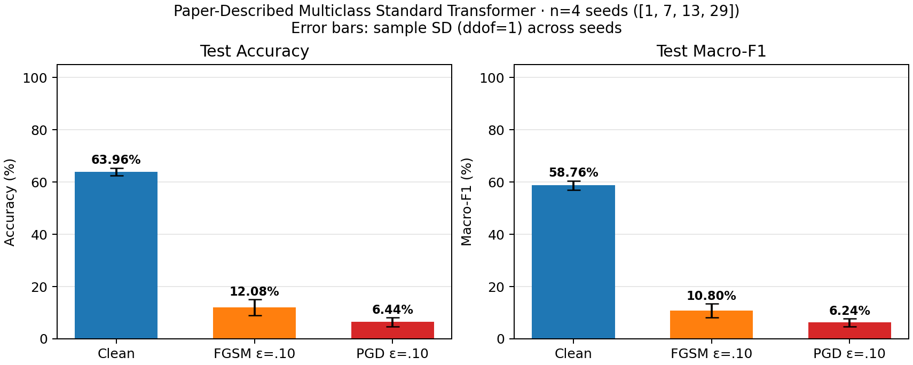

# Milestone 1: Paper-Described Configuration Experiment

**Paper-described configuration with documented assumptions; multiclass 27-class experiment; not a verified Table 4 reproduction.**

## 1. Objective, Scope and Status

This report presents the second Milestone 1 experiment: evaluating the PAVE Standard Transformer
using the settings described in the PAVE paper (DOI: https://doi.org/10.1016/j.hcc.2026.100426)
as closely as the available evidence and assignment constraints permit.

**Status:** Four full seeds completed and verified.
All 4 replication seeds ([1, 7, 13, 29]) completed the full 25-epoch budget and underwent Clean, FGSM,
and PGD evaluations on the full 4,500 held-out test partition.

Exact Table 4 reproduction remains unestablished. As documented in `docs/MILESTONE1_REFERENCE.md`, Table 4
in the paper appears in a binary classification context with an unverified dataset subset, unverified F1 averaging,
and unverified ASR denominator. This experiment evaluates the required 27-class multiclass intrusion detection task.
No quantization, QAT, adversarial training, or transfer evaluation is included here.

## 2. Setting Verification and Classification

Every setting is classified into:
- **A**: Explicitly supported by the paper text.
- **B**: Inherited from the released PAVE implementation.
- **C**: An assumption chosen for this experiment.

| Setting | Value | Class | Evidence & Reference | Notes / Conflicts |
|---|---|---|---|---|
| Feature scaling | MinMaxScaler fitted on training partition ONLY | A | Section 5.2, printed p.10 / PDF p.14 | Eliminates validation/test leakage from preprocessing |
| Partitioning | Stratified 70% train / 15% val / 15% test | A | Section 5.1, printed p.9 / PDF p.13 | 20,997 train, 4,500 val, 4,500 test rows |
| Split seed | 2025 (shared across seeds 1, 7, 13, 29) | C | Predetermined before execution | Single split ensures consistent test evaluation across training seeds |
| Optimizer | AdamW, lr=0.001, weight_decay=0.0001 | A / C | Section 5.1, printed p.9 / PDF p.13 | Paper states "Adam with weight decay 0.0001"; AdamW chosen for correct decoupled decay |
| Training budget | 25 epochs, batch size 512 | A | Section 5.1, printed p.9 / PDF p.13 | 42 batches/epoch (41 full of 512 + 1 of 5) → 1,050 total steps |
| Checkpoint rule | Final epoch 25 checkpoint | C | Not stated in paper | Declared before execution; no selection based on test performance |
| FGSM attack | eps=0.10, domain clipping to [0, 1] | A | Section 5.4, printed p.11 / PDF p.15 | Normalized feature bounds clipping applied after gradient step |
| PGD attack | eps=0.10, 7 steps, alpha=0.025, random start, domain clipping | A | Section 5.4, printed p.11 / PDF p.15 | Section 5.4 execution description chosen over Section 3.3 formula (alpha=eps/K=0.0143) |
| Architecture | Standard Transformer (39 in, 96 width, 4 heads, 3 layers, FFN 384, dropout 0.1) | A | Section 5.3 / Table 3 | Parameters: 351,612; mean pooling, 96→48→27 classifier |
| Sequence representation | Repeated row (50 tokens) + Gaussian noise 0.01 in training; noise-free in eval | C / B | Inherited from released code | Paper Sec 5.3 mentions length 10 for RNN; Transformer sequence format unspecified |
| Classification mode | Multiclass (27 classes) | C | Course assignment requirement | Table 4 classification mode unstated; binary context in Sec 3.1 |
| Seeds | [1, 7, 13, 29] | C | Maintained for cross-experiment consistency | Paper lists seeds 1, 7, 13, 21, 42 for Phase 2; Phase 1 seed list unverified |

## 3. Data Provenance and Partition Overlap Audit

- **Dataset**: `upstream/PAVE_artifact/data/balanced_CICIoT.csv`
- **SHA-256**: `0d869e334cc9a2795c96996fbde8fb04a8acac61f5e67c5d46aee2b0717a53ed`
- **Row count**: 29,997 rows, 39 features, 27 classes (1,111 rows per class).
- **Split**: 70% train (20,997 rows), 15% validation (4,500 rows), 15% test (4,500 rows).
- **Feature range**: All 39 features in training have nonzero variance. Test features fall entirely within [0.0, 1.0] after training-only min-max normalization. In validation, exactly two records produce values > 1.0 (Feature 20 SSH at 2.0, Feature 10 cwr_flag_number at 1.5).

### Duplicate Feature Overlap Audit

A random row split produces disjoint row IDs by construction. However, the source CSV contains substantial duplication:
- **Total rows**: 29,997 rows; **Unique feature patterns**: 11953.
- **Test rows with identical feature match in train**: 2804 / 4,500 (62.31%).
- **Test rows with identical (feature, label) match in train**: 2757 / 4,500 (61.27%).
- **Validation rows with identical feature match in train**: 2793 / 4,500 (62.07%).

> [!NOTE]
> This audit demonstrates that disjoint row IDs do NOT imply absence of duplicate feature leakage.
> In accordance with instructions, we preserve the paper-described stratified row split and document this leakage rather than silently substituting the group-based split.

## 4. Measured Experimental Results

All 4 seeds completed training and test evaluation on the full 4,500 test rows:

| Condition | Seeds | Accuracy (%) | Macro-F1 (%) | Weighted-F1 (%) | MCC | ASR (%) |
| --- | --- | --- | --- | --- | --- | --- |
| Clean | 4 | 63.956 ± 1.455 | 58.758 ± 1.734 | 58.780 ± 1.737 | 0.631 ± 0.015 | 0.000 ± 0.000 |
| FGSM | 4 | 12.083 ± 3.040 | 10.801 ± 2.680 | 10.799 ± 2.685 | 0.088 ± 0.032 | 84.009 ± 4.662 |
| PGD | 4 | 6.439 ± 1.758 | 6.241 ± 1.518 | 6.231 ± 1.523 | 0.029 ± 0.019 | 91.269 ± 2.867 |

Only verified full-budget seeds enter this table. Sample standard deviation is computed with **ddof=1** across the 4 seeds.

### Per-Seed Results Breakdown

| Seed | Condition | Accuracy (%) | Macro-F1 (%) | Weighted-F1 (%) | MCC | ASR (%) | ASR Numerator | ASR Denominator |
|---|---|---:|---:|---:|---:|---:|---:|---:|
| 1 | Clean | 63.044 | 57.260 | 57.280 | 0.6221 | 0.000 | 0 | 2837 |
| 1 | FGSM | 16.044 | 14.518 | 14.523 | 0.1303 | 80.261 | 2277 | 2837 |
| 1 | PGD | 7.689 | 6.915 | 6.907 | 0.0428 | 92.563 | 2626 | 2837 |
| 7 | Clean | 64.622 | 59.828 | 59.838 | 0.6379 | 0.000 | 0 | 2908 |
| 7 | FGSM | 10.689 | 10.170 | 10.168 | 0.0730 | 89.168 | 2593 | 2908 |
| 7 | PGD | 6.200 | 6.060 | 6.050 | 0.0266 | 90.853 | 2642 | 2908 |
| 13 | Clean | 62.489 | 57.308 | 57.331 | 0.6155 | 0.000 | 0 | 2812 |
| 13 | FGSM | 12.644 | 10.391 | 10.389 | 0.0947 | 79.872 | 2246 | 2812 |
| 13 | PGD | 7.822 | 7.771 | 7.765 | 0.0435 | 87.482 | 2460 | 2812 |
| 29 | Clean | 65.667 | 60.635 | 60.672 | 0.6497 | 0.000 | 0 | 2955 |
| 29 | FGSM | 8.956 | 8.125 | 8.116 | 0.0555 | 86.734 | 2563 | 2955 |
| 29 | PGD | 4.044 | 4.220 | 4.203 | 0.0036 | 94.179 | 2783 | 2955 |

### Runtime and Hardware Measurements

- **Platform**: arm (10 cores, macOS-26.6.2-arm64-arm-64bit)
- **PyTorch**: 2.14.1 (CPU mode, 2 threads)
- **Total Training Duration**: **1295.93 s** (21.60 min) across 4 seeds.
- **Total Evaluation Duration**: **59.36 s** (0.99 min) across 4 seeds.
- **Average Training Time per Seed**: **5.40 min**.

| Seed | Training (min) | Evaluation (min) | Peak process RSS (GiB) | Min system available (MiB) |
| --- | --- | --- | --- | --- |
| 1 | 5.42 | 0.25 | 1.82 | 2910.7 |
| 7 | 5.31 | 0.25 | 1.87 | 2446.5 |
| 13 | 5.58 | 0.25 | 1.70 | 2435.0 |
| 29 | 5.29 | 0.25 | 1.53 | 2712.1 |

## 5. Published Paper Context (Table 4)

Table 4 from the PAVE paper is presented below strictly as published context.
It is **not** an established target for this 27-class experiment; no difference column is presented because experimental conditions differ substantially.

| Condition | Table 4 Accuracy (%) | Table 4 F1 (%) | Table 4 ASR (%) | Paper notes |
| --- | --- | --- | --- | --- |
| Clean | 98.68 | 98.63 | not reported | Binary context in Sec 3.1; mode unverified |
| FGSM (eps 0.10) | 98.19 | 97.95 | 0.81 | ASR denominator unverified; binary attack-positive F1 |
| PGD (eps 0.10) | 98.19 | not reported | 0.81 | alpha conflict Sec 5.4 vs 3.3; F1 not reported |

## 6. Verification and Sanity Checks

Every completed seed passed an extensive verification suite:
1. **Model state preservation**: State hashes verify that `model.eval()` was active and model parameters were not modified during FGSM or PGD evaluations.
2. **Epsilon-zero identity**: Probing with $\epsilon=0$ confirmed exact input identity for both FGSM and PGD.
3. **Input gradients**: Autograd probe confirmed finite, nonzero gradients for model inputs.
4. **Perturbation bounds**: All perturbed examples satisfy $\|x_{adv} - x\|_\infty \le 0.10001$.
5. **Domain bounds**: All perturbed examples were strictly clipped to the normalized feature domain $[0.0, 1.0]$.
6. **Checkpoint reload consistency**: Re-loading the saved epoch 25 checkpoint yielded byte-identical logits on evaluation inputs.
7. **Complete evaluation population**: Exactly 4,500 test rows evaluated for all 3 conditions without subsampling or truncation.

## 7. Limitations and Threat Model

1. **Feature Space vs Physical Validity**: Perturbations operate directly on normalized continuous feature tensors. Unconstrained perturbations do not respect protocol semantics, flag combinations, packet lengths, or timing dependencies.
2. **Synthetic Sequences**: Repeating single tabular rows 50 times creates synthetic tokens, not real packet flows.
3. **Duplicate Leakage**: As revealed by the overlap audit, over 62% of test rows have duplicate feature vectors in the training partition due to natural duplicate flows in the underlying CICIoT capture.
4. **Non-Equivalence of Scaling**: Epsilon 0.10 in MinMaxScaler units represents a distinct physical perturbation from epsilon 0.10 in StandardScaler units.
