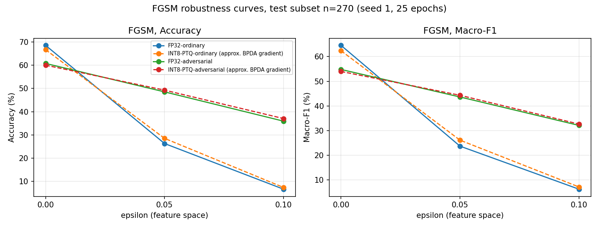
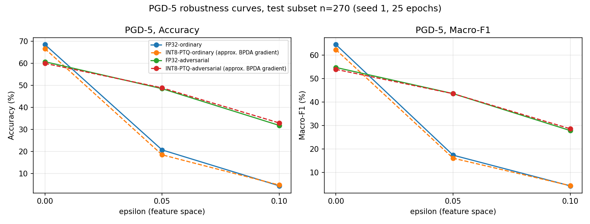

# Milestone 2 report: four-model comparison (reader-facing)

*Post-run document, edited for readers. The report the VM generated is preserved unchanged in [`original/m2_deadline_report.md`](original/m2_deadline_report.md).
All numbers below were recomputed on a laptop from the saved prediction files by [`verification/verify_m2.py`](../../verification/verify_m2.py)
(output: [`verify_m2.txt`](../../verification/results/verify_m2.txt), [`verify_m2.json`](../../verification/results/verify_m2.json)). No model was loaded and nothing was trained, run or attacked for this report.*

**Evidence tags used in this report**

- **[recomputed from predictions]** = recomputed from the saved prediction files in this repository. The same tag is used for sizes, id sets and hashes recomputed from the saved split files, and for timing and memory statistics recomputed from the saved raw efficiency JSONs (no predictions exist for timing).
- **[confirmed from a config or log]** = confirmed by reading a config, protocol, log or completion record. Not independently recomputed. This covers settings (epochs, seed, optimizer, calibration size and balance, scaler provenance, attack settings, run order).
- **[reported but not independently verified]** = stated by the original run or a source file, with no file in this repository or on the VM that allows a check.

**Five distinctions that apply to every number below**

| Do not mix | With | How this report keeps them apart |
|---|---|---|
| The four measured M2 models V1 to V4 | The separate QAT feasibility pilot (section 6) | Only V1 to V4 have accuracy, robustness and efficiency results. Full QAT was **deferred**. There is **no comparable QAT accuracy result and no measured QAT runtime estimate**. |
| Clean accuracy and macro-F1 on **all 3,764 test rows** | Robustness on the **same 270 selected rows for every model** | Different denominators (one row on 270 is 0.37 pp). The curve start (eps 0) is the 270-row score, not the 3,764-row score. |
| **One training seed** per parent (seed 1, one training run each) | **Three efficiency measurement repetitions** of the already trained models | The repetitions give timing spread only; they say nothing about training variance. |
| Metrics **recomputed from predictions** | Settings supported **only by configs, logs or hashes** | Tagged on each claim with the three labels above. |
| The **exact VM source** (`source/v4-base/`, `source/deadline-v1-overlay/`, byte-identical copies) | Any **post-run adaptation** (`post-run-adaptation/`, documentation only) | The M2 versions of files that conflict with the repository (`research/attacks.py`, `research/common.py`, `.gitattributes`, `pytest.ini`, `tests/conftest.py`) live under `source/` and **must not be silently replaced with the M1 versions at the repository root**. The reorganized layout was **not** tested end to end. |

## 1. Plain-language background

**What the model predicts.** The model is the PAVE "Standard Transformer". It gets one network-traffic record described by 39 numeric features (packet-header statistics, protocol flags and similar) and predicts **one of 27 labels**: benign traffic (`Benign_Final`) or one of 26 malicious traffic types (for example `DDoS-SYN_Flood`, `Recon-PortScan`, `Mirai-udpplain`). The unit is one dataset row, not a network flow in real time. To fit the Transformer, the row is repeated 50 times into a "sequence" of 50 identical positions; these are **not** 50 consecutive flows [confirmed from a config or log: [`training.json`](source/v4-base/configs/m2/training.json), [`split_m2.json`](evidence/v4-base/reports/milestone2b/split_v2/split_m2.json) class names].

**Two different kinds of "attack" in this report.** A *malicious-traffic label* (such as `DDoS-SYN_Flood`) is what the dataset says a row is. An *adversarial perturbation* is a tiny change to the 39 input numbers, chosen by an algorithm to make the model predict a wrong label. The labels never change; only the model input changes.

| Term | Meaning here |
|---|---|
| Clean evaluation | Scoring the model on unmodified test rows. |
| Adversarial training | Training where each update also uses perturbed copies of the training rows (here half clean loss, half perturbed loss), so the model sees attacks while learning. |
| PTQ (post-training quantization) | Converting an already trained FP32 (32-bit float) model to INT8 (8-bit integer weights) **without further training**, using a few calibration rows to choose the scaling. |
| QAT (quantization-aware training) | Training (or fine-tuning) with the quantization simulated, so the model can adapt to it. **Not run as a comparable model in this campaign (deferred; section 6).** |
| Epsilon (eps) | The largest allowed change to each feature, in units of that feature's training range (after scaling to 0..1). eps 0.05 means up to 5 % of the training range. |
| FGSM | Fast Gradient Sign Method: one gradient step of size eps. |
| PGD-5 | Projected Gradient Descent with 5 small steps (step size 0.25 x eps, random start, 1 restart), staying inside the eps limit. |
| BPDA gradient | For INT8 models the exact gradient is not usable. The attack runs the real INT8 model forward and uses an approximate backward pass through the dequantized weights. Attack strength on INT8 models may therefore be underestimated, so INT8 robustness may be over-estimated. |
| Macro-F1 | Average over all 27 labels of each label's F1 score; every label counts equally. A label that is never predicted correctly contributes 0. |
| Serialized size vs process memory | Serialized size is the bytes of the saved weights file. Process memory is how much RAM the running Python process used; it includes the Python and torch runtime and is a different quantity. |
| Batch-1 latency vs batch-256 time per example | Batch-1 latency is how long one row takes alone. Batch-256 time per example is the time for a batch of 256 rows divided by 256. They answer different questions and can point in opposite directions. |

## 2. Which experiment is this?

These are separate experiments. Their numbers are **not** merged or compared as a series in this report.

| Experiment | What it is | Where to read about it | Caveats kept from the original reports |
|---|---|---|---|
| PAVE published Table 4 | The result table of the PAVE paper. | [`docs/MILESTONE1_REFERENCE.md`](../../docs/MILESTONE1_REFERENCE.md), [M1 report](../milestone1-artifact/REPORT.md) | The paper's Section 3.1 describes a binary attack-versus-benign setting. Its classification mode, dataset subset, F1 averaging and ASR denominator are unresolved. It is **not** a verified 27-class or macro-F1 reference. |
| M1 released-code baseline | Our four-seed (1, 7, 13, 29) FP32 run of the released artifact code, 15 epochs, capped 3,000-row validation. | [`reports/milestone1-artifact/REPORT.md`](../milestone1-artifact/REPORT.md) | Whole-file scaler before splitting and possible duplicate leakage; validation results only; no matched-condition Table 4 reproduction is demonstrated. |
| Historical M1 AdamW variant | A teammate's four-seed FP32 run following the paper's text, using AdamW. | [`reports/milestone1-paper-described/REPORT.md`](../milestone1-paper-described/REPORT.md), [comparison](../milestone1-paper-described/COMPARISON.md) | Not independently verified and not an exact Table 4 reproduction; historical provenance is incomplete and review issues remain outstanding. |
| Corrected M1 Adam recreation | Variant C: `torch.optim.Adam` with weight decay 0.0001, new run directory, four seeds. | [`reports/milestone1-paper-described-adam/REPORT.md`](../milestone1-paper-described-adam/REPORT.md), [comparison](../milestone1-paper-described-adam/COMPARISON.md) | 62.31 % of test rows (2,804 of 4,500) have a feature pattern identical to a training row; no exact Table 4 reproduction is claimed. |
| **M2 four-model comparison (this report)** | One seed, new group-disjoint split, 25 epochs, FP32 and INT8 PTQ models, ordinary and adversarial training. | [`README.md`](README.md), this file | See section 5. |

M1 and M2 differ in split, scaler, epochs, sample sizes and attack settings. Differences between M1 and M2 numbers are **not** attributed to quantization (M1 had no INT8 model). The valid PTQ comparisons are **V2 versus V1** and **V4 versus V3 within M2** only. This report does not claim that Table 4 was reproduced under matched conditions.

## 3. Methods (from evidence)

### The four models

| ID | Model | How it was made |
|---|---|---|
| V1 | Ordinary FP32 | Trained 25 epochs, seed 1, ordinary loss. [confirmed from a config or log: [`train_log.json`](evidence/deadline-v1/models/V1/train_log.json) has 25 epoch losses, 1,100 updates and seed 1; [`latest.json`](evidence/deadline-v1/models/V1/ckpt/latest.json) points to epoch 25] |
| V2 | INT8 PTQ copy of V1 | Converted from the finished V1 (its recorded `float_state_hash` equals V1's final state hash). **No additional training epochs.** [confirmed from a config or log: [`conversion.json`](evidence/deadline-v1/models/V2/conversion.json), [`deadline_meta.json`](evidence/deadline-v1/models/V2/deadline_meta.json)] |
| V3 | Adversarially trained FP32 | Same recipe and same initial weights as V1 (equal initial state hash), 25 epochs, seed 1, plus PGD adversarial training. [confirmed from a config or log: [`train_log.json`](evidence/deadline-v1/models/V3/train_log.json)] |
| V4 | INT8 PTQ copy of V3 | Converted from the finished V3. **No additional training epochs.** [confirmed from a config or log: [`conversion.json`](evidence/deadline-v1/models/V4/conversion.json)] |

The `epochs: 25` field in V2/V4 metadata and the "Epochs 25" cell for the INT8 rows in the original report are the parent's training length carried over, not extra training ([discrepancy 1](../../verification/results/discrepancies.md)).

### Dataset, split and preprocessing

- **Dataset:** the processed CICIoT file `balanced_CICIoT.csv`, 29,997 rows, 39 features, 27 classes; hash and header were checked by the V4 preflight [confirmed from a config or log: [`preflight.json`](evidence/v4-base/output/m2b-v1/preflight.json), [`split_m2.json`](evidence/v4-base/reports/milestone2b/split_v2/split_m2.json)]. The dataset file itself is not in this repository.
- **Group-disjoint split:** rows with identical 39 feature values form a group (hash of the feature values; the label is not used), and a whole group goes to exactly one partition. Split seed 20270, partitions train 22,412 / validation 3,821 / test 3,764 rows (7,023 / 2,467 / 2,463 distinct feature vectors). [recomputed from predictions: sizes, disjointness, id hashes, see check group b in [`verify_m2.txt`](../../verification/results/verify_m2.txt)]
- **Preprocessing:** a min-max scaler (range 0 to 1, no clipping) fitted on the training rows only. [confirmed from a config or log: [`scaler_minmax.json`](evidence/v4-base/reports/milestone2b/split_v2/scaler_minmax.json) states "training rows only", 22,412 samples, and its training-id hash equals the training id hash. An independent scaler refit was **NOT performed**: the dataset is not in this repository, and none was permitted for this review.]
- **Limits of the split** (from [`split_report.md`](evidence/v4-base/reports/milestone2b/split_v2/split_report.md)): this is a new split of a dataset that M1 had already examined, not an untouched benchmark. 229 groups (8,697 rows) contain identical features with more than one label, so even a perfect classifier cannot exceed an accuracy ceiling of about 93.9 % on the test partition. Some classes are dominated by a single feature vector in training, and validation and test hold only about 20 to 275 rows per class, so per-class scores are noisy. A few held-out feature values lie outside the training range and are never clipped.
- **Repeated-row sequences:** each row is repeated 50 times; training adds Gaussian noise (std 0.01) to the sequence; evaluation adds none [confirmed from a config or log].

### Training-time and evaluation-time settings

| Training-time settings (V1 and V3) [confirmed from a config or log: [`training.json`](source/v4-base/configs/m2/training.json), train logs] | Evaluation-time settings [confirmed from a config or log: [`protocol.json`](evidence/deadline-v1/protocol/protocol.json)] |
|---|---|
| Seed 1, one training run per parent | Full clean test: all 3,764 test rows, batch 64 |
| Architecture: 3 layers, 4 heads, width 96, feed-forward 384, dropout 0.1; 351,612 parameters | Robustness subset: 270 test rows, 10 per class, frozen before test inference, same rows for every model |
| `torch.optim.Adam`, learning rate 0.001, weight decay 0.0001 (not decoupled), batch 512, no schedule, no gradient clipping | Perturbations in the min-max scaled feature space, L-infinity, eps 0, 0.05, 0.10; untargeted; one perturbation per row shared across its 50 repeated positions |
| 25 epochs (44 updates per epoch, 1,100 updates), cross-entropy loss, no class weights | FGSM: 1 step. PGD-5: 5 steps of 0.25 x eps, random start, 1 restart |
| Checkpoint rule: final epoch; no selection on validation or test data | FP32 models: gradient of the model itself. INT8 models: forward pass through the real INT8 model, backward pass approximated through dequantized weights (BPDA) |
| V3 only: PGD (eps 0.05, 5 steps of 0.025, random start) against the current weights each step; loss = 0.5 x clean + 0.5 x perturbed | Clean rows are never clipped or dropped; the allowed interval for each feature always contains its clean value |
| PTQ (V2, V4): static quantization, fbgemm backend, per-channel INT8 weights, 23 Linear layers (all of them); 540 calibration rows from the training partition (20 per class); attention matrix products, softmax, LayerNorm, residual additions, ReLU, positional encoding, pooling and the final sigmoid stay FP32 | Efficiency: one machine, 1 thread, fixed 256 validation rows; batch 1 with 20 warm-up and 200 timed calls, batch 256 with 5 warm-up and 30 timed calls; each measurement in a fresh process; 3 repetitions interleaved V1..V4 |

PTQ coverage: 347,632 of 351,612 parameters (98.87 %) are INT8 weights; the remaining parameters (biases, LayerNorm and similar) stay FP32; the model is a hybrid, not integer-only [confirmed from a config or log: [`conversion.json`](evidence/deadline-v1/models/V2/conversion.json)].

**Efficiency hardware** [confirmed from a config or log]: the V4 preflight records an Ubuntu 24.04 x86_64 VM with 8 cores, 33.65 GB RAM, AVX2 and AVX-512, Python 3.11.16 and torch 2.5.1 (CPU) ([`preflight.json`](evidence/v4-base/output/m2b-v1/preflight.json), taken the day before the campaign). The CPU model and the exact machine of the efficiency run are **not recorded** in the copied efficiency files (not verified). Memory is Linux VmHWM (peak resident set) of each fresh process.

**Which gradients are approximate.** For V2 and V4 the attack gradient is approximate (BPDA): activation quantization is ignored on the backward pass. FP32 models (V1, V3) use their exact gradient. Because the INT8 attacks may be weaker than attacks on the FP32 models, a higher INT8 robustness number does not show that INT8 is inherently more robust.

## 4. Results

### 4.1 Four-model comparison

Accuracy and macro-F1 use all 3,764 test rows; the macro-F1 averages all 27 labels (a label that is never predicted contributes 0; V1 and V2 never predict label 10, V3 and V4 never predict labels 10 and 20). Efficiency values are the median over 3 repetitions of the per-process medians. [recomputed from predictions (accuracy, F1) and from raw efficiency JSONs (timing, memory), see [`predictions_full_test.csv`](evidence/deadline-v1/test/predictions_full_test.csv), [`efficiency/results/`](evidence/deadline-v1/efficiency/results/01.json), [`model_comparison.csv`](evidence/deadline-v1/results/model_comparison.csv)]

| Model | Accuracy, full test (n=3,764) | Macro-F1, full test | Serialized size (bytes) | Batch-1 latency, median (ms) | Batch-1 latency, p95 (ms) | Batch-256 time per example (ms) | Process peak memory, VmHWM (MB) | Peak above post-load baseline (MB) |
|---|---|---|---|---|---|---|---|---|
| V1 FP32 ordinary | 61.96% | 56.80% | 1,448,741 | 2.876 | 3.144 | 1.2416 | 446.44 | 122.03 |
| V2 INT8 PTQ of V1 | 61.77% | 56.89% | 497,448 | 5.358 | 5.858 | 1.0529 | 475.71 | 135.82 |
| V3 FP32 adversarially trained | 53.85% | 49.90% | 1,448,741 | 2.900 | 3.203 | 1.2467 | 446.56 | 122.04 |
| V4 INT8 PTQ of V3 | 53.93% | 49.94% | 497,448 | 5.397 | 6.038 | 1.0836 | 471.94 | 131.63 |

- **Size:** the INT8 serialized state is 34.3 % of the FP32 one (497,448 vs 1,448,741 bytes) [recomputed from predictions]. The on-disk files are slightly larger (checkpoint 1,450,583 B and INT8 state 499,961 B) and are listed in the evidence README; this is a third quantity.
- **Batch-1 latency:** INT8 is **slower** than its FP32 parent on this machine (about 5.4 ms vs 2.9 ms, a ratio of about 1.86) [recomputed from predictions].
- **Batch-256 time per example:** INT8 is **lower** (1.053 and 1.084 ms vs 1.242 and 1.247 ms, ratios 0.85 and 0.87) [recomputed from predictions]. The three batch-256 repetitions of the INT8 models spread widely (V2 244.6 to 299.5 ms per batch, V4 272.1 to 295.4 ms) compared with FP32 (about 315 to 322 ms), so the size of this gain is uncertain.
- **Process memory:** INT8 peak memory (VmHWM) is **not lower** (ratios 1.07 and 1.06) [recomputed from predictions]; process memory is dominated by the Python and torch runtime, not by the weights.
- These are descriptive measurements on one machine at 1 thread, not claims about other hardware. The 3 repetitions are 3 timing runs of the same trained models, not 3 training runs.
- Agreement of each INT8 copy with its FP32 parent on the test rows: V2 vs V1 3,524 of 3,764 (93.62 %), V4 vs V3 3,319 of 3,764 (88.18 %) [recomputed from predictions].

### 4.2 Robustness (270-row subset)

The subset is a **different set of rows with a different denominator** from the full test (270 vs 3,764). One row on the subset moves a score by 0.37 percentage points (pp). The curve start (eps 0) is the clean score **on the subset**, which is higher than the full-test score for every model (for example V1: 68.52 % on the subset vs 61.96 % on the full test) [recomputed from predictions]. The 270 eps-0 predictions of every model equal that model's full-test predictions for the same ids (270 of 270 for all four models) [recomputed from predictions].

Accuracy (%), recomputed from [`predictions_subset.csv`](evidence/deadline-v1/robustness/predictions_subset.csv):

| Model (accuracy, %, n=270) | clean (eps 0) | FGSM 0.05 | FGSM 0.10 | PGD-5 0.05 | PGD-5 0.10 |
|---|---|---|---|---|---|
| V1 FP32 ordinary | 68.52 | 26.30 | 6.67 | 20.74 | 4.44 |
| V2 INT8 PTQ of V1 | 66.67 | 28.52 | 7.41 | 18.52 | 4.81 |
| V3 FP32 adversarially trained | 60.74 | 48.52 | 35.93 | 48.52 | 31.85 |
| V4 INT8 PTQ of V3 | 60.00 | 49.26 | 37.04 | 48.89 | 32.96 |

Macro-F1 (%), 27 labels, same rows:

| Model (macro-F1, %, n=270) | clean (eps 0) | FGSM 0.05 | FGSM 0.10 | PGD-5 0.05 | PGD-5 0.10 |
|---|---|---|---|---|---|
| V1 FP32 ordinary | 64.54 | 23.71 | 6.27 | 17.38 | 4.29 |
| V2 INT8 PTQ of V1 | 62.38 | 26.14 | 7.17 | 16.09 | 4.37 |
| V3 FP32 adversarially trained | 54.78 | 43.63 | 32.12 | 43.63 | 27.88 |
| V4 INT8 PTQ of V3 | 53.97 | 44.32 | 32.65 | 43.60 | 28.63 |

Figures (original run, preserved unchanged; the values plotted were recomputed and match, see [`figure_review.md`](../../verification/results/figure_review.md)):

[Post-run regeneration from saved predictions](../../verification/figures/fgsm_recomputed.png) ([PGD-5](../../verification/figures/pgd5_recomputed.png)) is provided for comparison; the originals above were not regenerated.

### 4.3 Within-M2 PTQ comparisons and the adversarial-training trade-off

Differences in percentage points. Sign is INT8 minus FP32 parent. [recomputed; they equal [`pp_differences.json`](evidence/deadline-v1/results/pp_differences.json)]

| Condition (subset n=270 unless stated) | V2 - V1 accuracy (pp) | V4 - V3 accuracy (pp) | V2 - V1 macro-F1 (pp) | V4 - V3 macro-F1 (pp) |
|---|---|---|---|---|
| Clean, full test (n=3,764) | -0.19 | +0.08 | +0.09 | +0.05 |
| clean (eps 0) (subset) | -1.85 | -0.74 | -2.16 | -0.81 |
| FGSM 0.05 (subset) | +2.22 | +0.74 | +2.43 | +0.69 |
| FGSM 0.10 (subset) | +0.74 | +1.11 | +0.90 | +0.53 |
| PGD-5 0.05 (subset) | -2.22 | +0.37 | -1.29 | -0.03 |
| PGD-5 0.10 (subset) | +0.37 | +1.11 | +0.08 | +0.75 |

On the full test, PTQ moved accuracy by -0.19 pp (V2 vs V1) and +0.08 pp (V4 vs V3). Under attack the signs differ across settings (for example V2 vs V1 is +2.22 pp for FGSM 0.05 and -2.22 pp for PGD-5 0.05). Differences of a few rows on 270 are within what one run can produce. **They do not show that INT8 is equivalent to FP32, that the differences are statistically significant, or that INT8 has an inherent robustness benefit.** No confidence intervals or significance tests were computed.

Adversarial training (comparing V3 with V1, same recipe otherwise): full-test clean accuracy is 8.10 pp lower (53.85 % vs 61.96 %), while accuracy under PGD-5 at eps 0.10 on the subset is higher (31.85 % vs 4.44 %). For the INT8 pair the corresponding numbers are 61.77 % vs 53.93 % clean (-7.84 pp) and 4.81 % vs 32.96 % under PGD-5 at eps 0.10 [recomputed from predictions]. This is one seed and one training run per parent.

### 4.4 Cross-check against previously reported values

Reported values were used only as a check, never as targets. Nothing was altered.

| Value | Recomputed from predictions | Previously reported | Status |
|---|---|---|---|
| V1 clean accuracy, full test | 61.9554 % | 61.96 % | equal after display rounding |
| V2 clean accuracy | 61.7694 % | 61.77 % | equal after rounding |
| V3 clean accuracy | 53.8523 % | 53.85 % | equal after rounding |
| V4 clean accuracy | 53.9320 % | 53.93 % | equal after rounding |
| V2 PGD-5 accuracy at eps 0.10 (13 of 270) | 4.8148 % | 4.81 % | equal after rounding |
| V4 PGD-5 accuracy at eps 0.10 (89 of 270) | 32.9630 % | 32.96 % | equal after rounding |

Recomputed accuracy and macro-F1 equal the stored values in `clean_results.json` and `robustness_results.json` exactly (difference 0), and the macro-F1 was cross-checked with scikit-learn. No difference beyond display rounding was found.

### 4.5 Where to verify each headline result

| Result | Tag | File to check |
|---|---|---|
| Clean accuracy and macro-F1 (V1..V4) on 3,764 ids | recomputed from predictions | [`predictions_full_test.csv`](evidence/deadline-v1/test/predictions_full_test.csv), [`clean_results.json`](evidence/deadline-v1/test/clean_results.json) |
| Same 3,764 ids and labels for every model | recomputed from predictions | [`predictions_full_test.csv`](evidence/deadline-v1/test/predictions_full_test.csv) (one id and label column shared by all models) |
| 270 subset ids, 10 per class, same ids and labels for all 20 model-by-condition groups | recomputed from predictions | [`robustness_subset_ids.csv`](evidence/deadline-v1/protocol/robustness_subset_ids.csv), [`predictions_subset.csv`](evidence/deadline-v1/robustness/predictions_subset.csv) |
| Robustness tables and curves | recomputed from predictions | [`predictions_subset.csv`](evidence/deadline-v1/robustness/predictions_subset.csv), [`robustness_curves.csv`](evidence/deadline-v1/results/robustness_curves.csv) |
| eps-0 predictions equal full-test predictions (270 of 270) | recomputed from predictions | both prediction files; [`robustness_results.json`](evidence/deadline-v1/robustness/robustness_results.json) |
| Size, batch-1 latency, batch-256 per example, memory | recomputed from raw measurement files (no predictions exist for timing) | [`efficiency/results/*.json`](evidence/deadline-v1/efficiency/results/01.json), [`efficiency.json`](evidence/deadline-v1/efficiency/efficiency.json) |
| Parents trained 25 epochs, seed 1, final-epoch checkpoint | confirmed from a config or log | [`V1 train_log.json`](evidence/deadline-v1/models/V1/train_log.json), [`V3 train_log.json`](evidence/deadline-v1/models/V3/train_log.json), [`train_ordinary.ok`](evidence/deadline-v1/stage_markers/train_ordinary.ok), [`train_adversarial.ok`](evidence/deadline-v1/stage_markers/train_adversarial.ok) |
| INT8 copies converted from parents, 23 layers, 540 calibration rows | confirmed from a config or log | [`V2 conversion.json`](evidence/deadline-v1/models/V2/conversion.json), [`V4 conversion.json`](evidence/deadline-v1/models/V4/conversion.json), [`calibration_ids.json`](evidence/deadline-v1/calibration/calibration_ids.json) |
| Split, scaler, calibration ids and hashes (sizes, disjointness, id hashes recomputed) | recomputed from the saved split files (sizes, disjointness, id hashes); scaler and calibration statements confirmed from a config or log; no scaler refit or calibration reconstruction was performed | [`split_m2.json`](evidence/v4-base/reports/milestone2b/split_v2/split_m2.json), [`scaler_minmax.json`](evidence/v4-base/reports/milestone2b/split_v2/scaler_minmax.json), [`protocol.json`](evidence/deadline-v1/protocol/protocol.json) |
| Checkpoint file hashes (V1..V4 weights, calibration tensor) | confirmed from a config or log (recorded hashes); file hashes also recomputed directly on the VM files, POST-RUN (no model loaded) | stage markers (`ptq.ok`, `train_*.ok`) and `ckpt/latest.json`. The checkpoint files are not in this repository and were never loaded. POST-RUN: all 59 hashes recorded in the stage markers and `latest.json` were recomputed directly on the VM files and matched, including V1 and V3 `checkpoint.pt`, V2 and V4 `state.pt`, `calibration_x.pt` and the V1 and V3 `epoch_025.pt` ([`vm_hash_check_postrun.tsv`](../../verification/results/vm_hash_check_postrun.tsv); repeatable only with the VM folder) |
| Training wall-clock (V1 1,210 s, V3 9,267 s) | confirmed from a config or log | `train_log.json` of each parent |

## 5. What this report does not establish

- **One seed and one training run per parent.** There is no spread across seeds. The three efficiency repetitions are repeated timings of the same trained models, not three training runs.
- **Different denominators.** Clean accuracy and macro-F1 use all 3,764 test rows; the robustness tables use 270 rows. The two sets of numbers must not be mixed; the curve start is the subset score.
- **Limited attack coverage.** Robustness was measured only for FGSM and 5-step PGD with the settings above, at eps 0.05 and 0.10. Stronger attacks, more restarts, other step counts, transfer attacks and attacks on larger subsets were not run (the protocol lists `pgd20`, `pgd50x5`, transfer, surrogate and direct-INT8-gradient attacks as not run).
- **Feature-space perturbations.** The perturbations change numeric features directly. A perturbed vector need not correspond to realizable network traffic.
- **Small differences.** The PTQ differences are small and sometimes of opposite sign. They do not show equivalence, statistical significance, or an inherent robustness benefit from INT8. INT8 attack gradients are approximate, so INT8 robustness may be over-estimated.
- **Dataset limits.** The split is new but the dataset had already been used in M1; identical feature vectors with different labels remain; per-class test sets are small.
- **Hardware.** Efficiency was measured on one machine with one thread. The latency ordering (batch 1 slower, batch 256 faster for INT8) is a description of these measurements only.
- **Not verified here:** an independent scaler refit and a reconstruction of the calibration set were **NOT performed** (per-class calibration balance and scaler provenance are only [confirmed from a config or log]); the CPU model of the efficiency run; the contents of the checkpoints (their file hashes were recomputed, POST-RUN, but no model was loaded). **Restart behaviour:** the campaign logs were read (section 7). They show no interruption and no restart during training, so recovery from an interrupted run was **not exercised and is not demonstrated**.
- **No comparison with the paper's Table 4.** Table 4 is not a verified 27-class or macro-F1 reference, and no matched-condition reproduction is claimed.
- **Milestone 3 is pending.** Planned work is not presented as a result.

## 6. QAT: deferred

The QAT feasibility pilot is **not** one of the four measured models and produced **no comparable QAT accuracy result and no measured QAT runtime estimate for a full QAT arm**.

- **What the pilot evidence shows (and nothing more):** a bounded QAT *feasibility* check ran with status `supported` [confirmed from a config or log: [`qat_feasibility.json`](evidence/v4-base/m2a-pilot/qat/qat_feasibility.json)]. One training epoch on 2,700 training rows (learning rate 0.0001) completed without error, the model converted to INT8 (23 layers), the converted model was serialized, and INT8 inference on 540 rows ran with finite outputs. The file's own claim reads "bounded feasibility check only; not a QAT result and not comparable with PTQ without the matched FP32-FT controls". The file also stores a number for its 540 evaluation rows; it comes from a one-epoch plumbing check, it is not reported or interpreted here, and it must not be read as a QAT accuracy. The pilot used a different split and calibration set from the campaign (split seed 20260; see [discrepancy 12](../../verification/results/discrepancies.md)) and ran on a different machine.
- **What does not exist:** a comparable full QAT model with the same 25-epoch budget, split and evaluation. Full QAT was **deferred**: it was not run in this campaign. Nothing in the evidence says it is technically impossible (the pilot ran).
- **No runtime estimate:** the pilot's own wall-clock (about 35 s for its single epoch, on the pilot machine) is not an estimate for full QAT, and no file contains one. The deadline campaign was configured for a 12-hour deadline, at most 9 hours of compute and a 3-hour reserve. The timing probe chose 25 epochs and 10 rows per class from runtime alone, with a planned 3.82 hours (including a 1.25 safety multiplier) for two FP32 parents, PTQ, evaluation and efficiency, and no QAT stage [confirmed from a config or log: [`HANDOFF.md`](source/deadline-v1-overlay/HANDOFF.md) sections 10 and 12, [`m2_deadline_v1.json`](source/deadline-v1-overlay/configs/m2_deadline_v1.json), [`budget_lock.json`](evidence/deadline-v1/timing/budget_lock.json), [`timing_estimate.json`](evidence/deadline-v1/timing/timing_estimate.json)]. How much of the budget QAT would have needed is **not known**.
## 7. Discrepancies and provenance

- Where sources disagree, what each says and which supports the result: [`discrepancies.md`](../../verification/results/discrepancies.md). No difference beyond display rounding was found in any headline number.
- **V4 base vs deadline overlay.** The V4 base package supplied the split, scaler, training, quantization, attack and efficiency code and the QAT pilot ([`source/v4-base/`](source/v4-base/)). The deadline overlay `m2-deadline-v1` supplied the timing, launch, resume and report commands and the config for the campaign that produced all numbers here ([`source/deadline-v1-overlay/`](source/deadline-v1-overlay/)). The overlay does not modify V4. Both are byte-identical copies, listed with SHA-256 in [`source/README.md`](source/README.md).
- The campaign's run identity records the hashes of the executed source files; the copies match them ([`run_identity.json`](evidence/deadline-v1/run_identity.json), check group i of the verification).
- **Exact VM source versus post-run adaptation.** `source/v4-base/` and `source/deadline-v1-overlay/` are the code that existed on the VM. `post-run-adaptation/` holds only a documentation note; no adapted code exists. Files whose names collide with the repository but differ in content (`research/attacks.py`, `research/common.py`, `.gitattributes`, `pytest.ini`, `tests/conftest.py`) are kept only under `source/`. The M1 versions at the repository root were not replaced, and they must not be replaced silently: the M2 code needs its own `attacks.py` and `common.py`.
- **Campaign execution record (POST-RUN reading of the logs, [`logs/`](evidence/deadline-v1/logs/campaign-20261117T123716Z.log.txt)).** The first launch (12:31:49Z) ran preflight and freeze and then stopped on request. A resume at 12:32:00Z found freeze already valid and ran nothing; **that no-op resume is not evidence of recovery during training**. A second resume at 12:37:16Z ran `train_ordinary` (1,213 s), `train_adversarial` (9,267 s), PTQ, validation check, clean test, robustness, efficiency and report in order, each stage with one start line and one completion marker and no error, interruption or restart line. The logs therefore record no restart during training; the per-epoch checkpoint-resume path was not exercised as far as the logs show. The V4 smoke campaign (separate, not used) is not covered by these logs.
- The older V4 smoke run's Stage 04 did not pass (48 minutes against a 45-minute limit, [`HANDOFF.md`](source/deadline-v1-overlay/HANDOFF.md) section 4). The campaign never read it and its outputs are not copied.
- **No end-to-end reproduction from this repository layout was performed.** The post-run adaptation note is [`post-run-adaptation/README.md`](post-run-adaptation/README.md).
